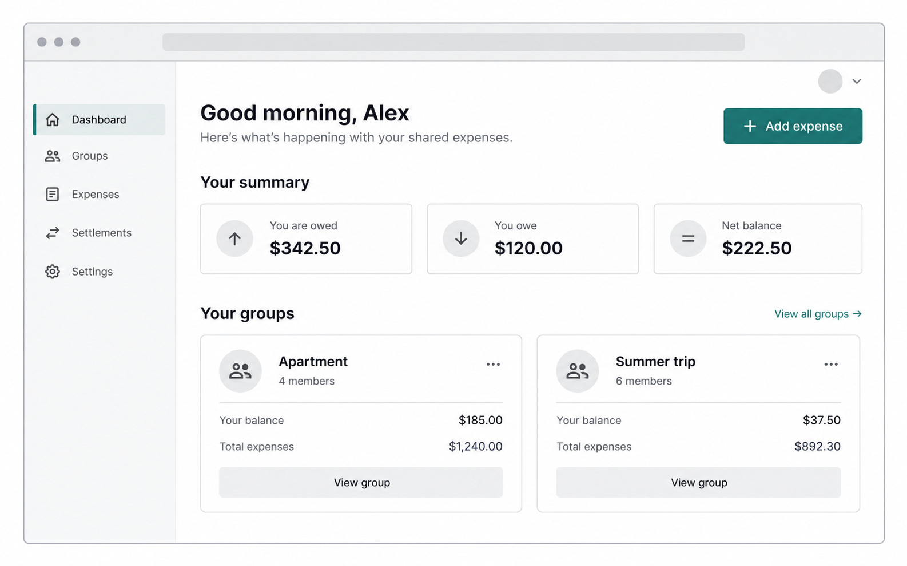
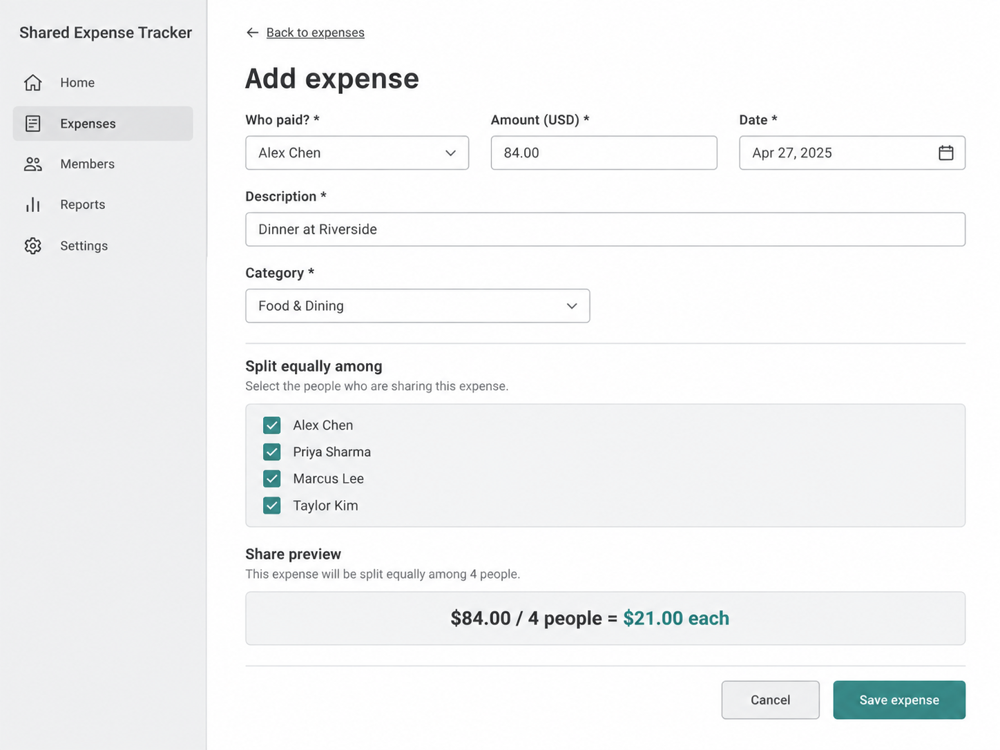
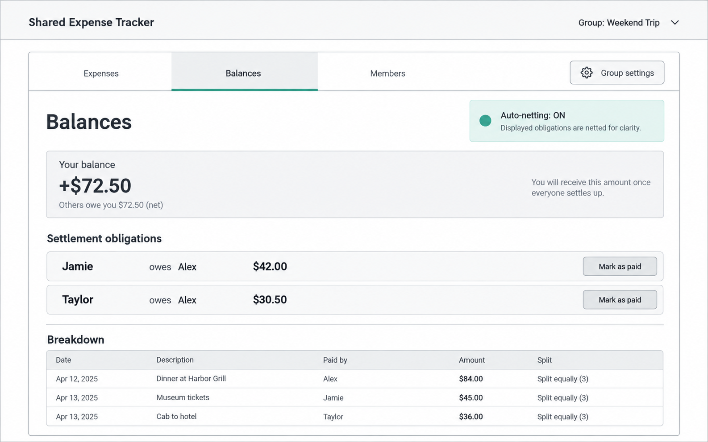

# Shared Expense Tracker

Product overview, MVP scope, interface wireframes, data models, and API plan.

## 1. Project Description

Shared Expense Tracker helps roommates, trip groups, and other small groups manage shared costs without requiring complex accounting. Members create groups, add categorized expenses, split costs evenly in the MVP, review a traceable balance breakdown, and mark debts as paid. Users can belong to multiple groups. All amounts are stored and displayed in USD.

The central product principle is clarity: each displayed balance should be explainable from the underlying expenses, and any auto-netted result should be explicitly labeled.

### Current implementation snapshot — October 21, 2026

The active implementation is `sveltekit/` and uses SvelteKit server loads/form actions with MongoDB. The working flow is email or Google sign-in → group creation/discovery → membership request and creator approval → equal-split expense entry → edit or soft delete → paid-share tracking → in-app notifications. Group membership is checked on the server for every group-scoped load and action.

Calculated balances, auto-netting, settlement records/history, custom splits, and automated browser/accessibility tests remain roadmap items. The REST-style endpoint list in this document is the target contract for those future capabilities; the current app does not expose a separate REST API.

### Additional requested behavior for the next implementation pass

- Mark notifications as read after the visitor remains on `/notifications` for at least three seconds.
- Link dashboard recent-expense entries to the corresponding expense view.
- Allow the expense creator to mark any participant as paid; allow other users to mark only their own share.
- Use a session-only login cookie and expire the server session after 20 minutes of inactivity.

These are requirements to implement next and are intentionally not represented as completed behavior in the current status below.

## 2. Target Audience and Users

- Roommates splitting utilities, groceries, household supplies, and shared purchases
- Friends or family sharing travel, event, or vacation expenses
- Small groups that want simple, fair expense tracking without advanced accounting tools

The MVP has no administrator role. Group members can participate in expense tracking, with final authorization rules for membership, editing, deletion, and settlement to be confirmed before implementation.

## 3. MVP Core Features

| Feature area | MVP implementation |
|---|---|
| Authentication | **Implemented:** email signup/login/logout, Google login, sessions, and authenticated dashboard entry. |
| Groups | **Partial:** create/list/search groups, request membership, creator approval/rejection, rename, member removal, and multiple memberships. Manual add and auto-netting configuration remain planned. |
| Expenses | **Implemented for equal split:** create, list, edit, soft-delete, payer, amount, date, description, category, exact cent splits, and paid-share flags. |
| Balances | **Planned:** calculated per-person totals, traceable breakdowns, group totals, and optional auto-netted obligations. |
| Settlements | **Partial:** users can toggle a split’s paid flag; settlement records and history are planned. |
| Core views | **Partial:** dashboard, group page, add-expense form with preview, edit view, join-group discovery, creator settings, notifications, and responsive styling. Dedicated balance/user-summary views remain planned. |

## 4. Additional Features

Planned beyond the initial MVP:

- Custom splits by percentage, shares, or unequal amounts
- In-app notifications, email, and mobile push notifications
- Restore deleted expenses during the retention window
- Recurring expenses
- Comments and activity notes on expenses
- Export group history
- Enhanced mobile UI beyond quick-add
- Email-based group invitations
- Bank or payment-provider integrations
- Receipt scanning
- Multi-currency support
- Advanced permissions or roles
- Automated recurring billing
- AI-assisted categorization or expense entry

## 5. Interface Wireframes and Mockups

These are low-fidelity layout references. They establish the primary information hierarchy and interaction targets; visual styling, responsive behavior, and accessibility details will be refined during UI implementation.

### Dashboard

Primary landing page after sign-in. The user can scan groups, balances, and the main action quickly.

### Add Expense

Fast entry form for the MVP equal-split flow, with a visible share preview before saving.

### Balances

Group-level balance view showing totals, traceable details, and the auto-netting state.

### Core interaction flow

Sign in → choose or create a group → add an expense → review updated balances → record a settlement.

The dashboard provides the cross-group overview; the group page provides the source-of-truth detail.

## 6. Initial Data Models

Amounts use integer USD cents rather than floating-point values. Active records use timestamps for auditability. Soft-deleted expenses retain a deletion timestamp so the 30-day purge rule can be enforced.

### User

- `id`
- `name`
- `email` — unique
- `auth_provider` — `email` or `google`
- `created_at`
- `updated_at`

Account identity and authentication metadata.

### Group

- `id`
- `name`
- `created_by_user_id`
- `auto_netting_enabled`
- `created_at`
- `updated_at`

A shared expense context.

### GroupMember

- `id`
- `group_id`
- `user_id`
- `joined_at`
- Unique constraint on (`group_id`, `user_id`)

Membership join record.

### ExpenseCategory

- `id`
- `name`
- `description`
- `is_system_category`

System or optionally group-defined category.

### Expense

- `id`
- `group_id`
- `payer_user_id`
- `description`
- `amount_usd_cents`
- `date`
- `category_id`
- `created_by_user_id`
- `deleted_at` — null while active
- `created_at`
- `updated_at`

The original shared charge.

### ExpenseSplit

- `id`
- `expense_id`
- `user_id`
- `share_usd_cents`
- Unique constraint on (`expense_id`, `user_id`)

Explicit equal-split allocation that also supports future custom splits.

### Settlement

- `id`
- `group_id`
- `from_user_id`
- `to_user_id`
- `amount_usd_cents`
- `date_paid`
- `notes`
- `created_by_user_id`
- `created_at`

A payment between members that can settle a netted balance across multiple expenses.

### Model rules

- The payer and every split participant must belong to the group.
- Split shares must sum exactly to the expense amount.
- Deleted expenses are excluded from active balance calculations.
- Historical expenses should remain auditable if membership later changes.

## 7. Target API Endpoints

The following REST-style endpoints represent the target contract for the planned API surface. The current SvelteKit implementation uses server loads and form actions instead of separate `/api` endpoints. They can be implemented through REST, RPC, or GraphQL as long as the same capabilities and authorization rules are preserved.

| Area | Endpoint | Interaction |
|---|---|---|
| Authentication | `POST /auth/email/login` | Start or complete email authentication |
| Authentication | `GET /auth/google/start` | Begin Google authentication |
| Authentication | `POST /auth/logout` | End current session |
| Authentication | `GET /me` | Return authenticated user |
| Groups | `GET /groups` | List groups for current user |
| Groups | `POST /groups` | Create group and initial membership |
| Groups | `GET /groups/{groupId}` | Return group details and members |
| Groups | `PATCH /groups/{groupId}` | Rename group or update auto-netting |
| Members | `POST /groups/{groupId}/members` | Add existing user manually |
| Members | `DELETE /groups/{groupId}/members/{userId}` | Remove a member after validation |
| Categories | `GET /expense-categories` | List available categories |
| Categories | `POST /expense-categories` | Create optional group category |
| Expenses | `GET /groups/{groupId}/expenses` | List active expenses with filters and pagination |
| Expenses | `POST /groups/{groupId}/expenses` | Create expense and equal splits |
| Expenses | `GET /expenses/{expenseId}` | Return expense and split details |
| Expenses | `PATCH /expenses/{expenseId}` | Edit expense and recalculate splits |
| Expenses | `DELETE /expenses/{expenseId}` | Soft-delete expense |
| Balances | `GET /groups/{groupId}/balances` | Return raw balances, netted balances, totals, and indicator |
| Settlements | `GET /groups/{groupId}/settlements` | List settlement history |
| Settlements | `POST /groups/{groupId}/settlements` | Record payment between members |
| Settlements | `DELETE /settlements/{settlementId}` | Correct or reverse settlement if permitted |

### Implementation rules for every endpoint

- Verify group membership for every group-scoped request.
- Validate payer and split participants against current group membership.
- Validate positive USD cents and avoid floating-point arithmetic.
- Exclude soft-deleted expenses from active lists and balance calculations.
- Return enough balance metadata to explain how auto-netting changed the displayed obligations.
- Make soft deletion idempotent and preserve the deletion timestamp for the purge job.

## Release Boundary and current next steps

The current prototype boundary is complete when a user can sign in, create or discover a group, obtain membership approval, record an equal-split expense, edit or delete it, mark shares paid, and receive relevant notifications. Before calling the original MVP release complete, implement calculated balances, traceable obligations, and settlement history, then add automated responsive/accessibility coverage. Custom splits, external money movement, and multi-currency accounting remain outside the MVP.

